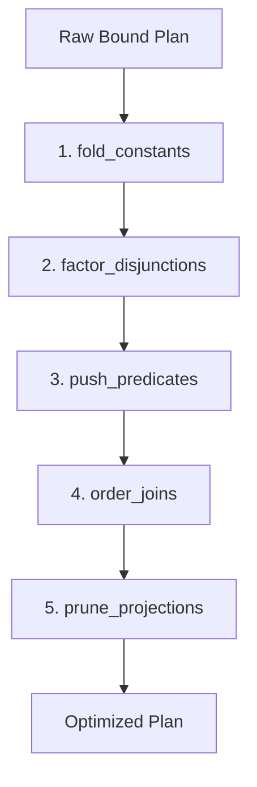

# SQL Frontend and Optimizer

This document describes `morsel-sql`, the SQL query compiler and optimizer for the morsel analytical query engine. `morsel-sql` parses SQL text, binds identifiers and expressions against the table catalog, infers types and inserts necessary coercions, decorrelates subqueries into relational joins, and applies rule-based query optimizations to produce an executable physical plan.

---

## 1. Supported SQL Subset and Rejections

morsel implements the analytical SQL subset required to execute TPC-H queries (Q1 through Q22).

### Supported Query Structure

- **Statements**: A single `SELECT` query statement, optionally preceded by a `WITH` clause containing one or more Common Table Expressions (CTEs).
- **FROM Clause**:
  - Base table scans (e.g., `FROM lineitem`).
  - Table aliases (`FROM customer AS c` or `FROM customer c`).
  - Comma-separated cross-joins (`FROM customer, orders, lineitem`).
  - Explicit inner and left outer joins (`FROM orders LEFT OUTER JOIN lineitem ON ...`).
  - Derived subqueries / table subqueries (`FROM (SELECT ...) AS derived (col1, col2)`).
- **WHERE Clause**:
  - Boolean conjunctions (`AND`), disjunctions (`OR`), and negations (`NOT`).
  - Comparison operators (`=`, `<>`, `!=`, `<`, `<=`, `>`, `>=`).
  - Range tests (`BETWEEN low AND high`, desugared to `expr >= low AND expr <= high`).
  - Membership tests (`IN (val1, val2, ...)` and `NOT IN (...)`).
  - Pattern matching (`LIKE` and `NOT LIKE` with `%` and `_` wildcards).
  - Null testing (`IS NULL` and `IS NOT NULL`).
  - Subquery predicates (`EXISTS`, `NOT EXISTS`, `IN (SELECT ...)`, `NOT IN (SELECT ...)`, and scalar subquery comparisons).
- **GROUP BY Clause**:
  - Grouping by column names, column expressions, or 1-based integer ordinals referring to SELECT items (e.g., `GROUP BY 1, 2`).
- **HAVING Clause**:
  - Conditions over aggregate functions and grouping columns, including scalar subqueries.
- **ORDER BY Clause**:
  - Ordering by expressions or 1-based column ordinals, with optional `ASC`/`DESC` directions and `NULLS FIRST`/`NULLS LAST` modifiers.
- **LIMIT Clause**:
  - Constant integer limits restricting maximum output row count (e.g., `LIMIT 10`).

### Supported Functions and Expressions

- **Aggregate Functions**:
  - `SUM(expr)`: Exact summation for integer and decimal inputs; floating-point summation for float inputs.
  - `AVG(expr)`: Always returns `Float64`.
  - `MIN(expr)` and `MAX(expr)`: Retains the input column data type.
  - `COUNT(*)` / `COUNT(1)`: Emits row count as `Int64`.
  - `COUNT(expr)`: Counts non-null values as `Int64`.
  - `COUNT(DISTINCT expr)`: Computes distinct non-null count as `Int64`.
- **Scalar Functions**:
  - `SUBSTRING(expr FROM start FOR len)` or `SUBSTRING(expr, start, len)`: 1-based character slicing over string values.
  - `EXTRACT(YEAR FROM date_expr)`: Extracts the integer calendar year from a date.
  - `COALESCE(arg1, arg2, ...)`: Returns the first non-null argument, rewritten internally as a chained `CASE` expression.
- **Conditional Expressions**:
  - `CASE WHEN cond THEN result ... [ELSE else_result] END`.
  - `CASE operand WHEN match THEN result ... [ELSE else_result] END` (desugared to equality checks).
- **Date Arithmetic**:
  - Date and interval expressions: `date_expr + INTERVAL 'n' DAY/MONTH/YEAR` and `date_expr - INTERVAL 'n' DAY/MONTH/YEAR`.

### Rejections and Error Messages

The binder enforces strict dialect boundaries. When unsupported SQL features or invalid references are encountered, it halts planning immediately with descriptive error text:

| Scenario | Rejection Error Text |
|:---|:---|
| Empty input | `empty sql query` |
| Semicolon-separated statements | `multiple sql statements not supported` |
| Non-SELECT statement (INSERT, DDL, etc.) | `unsupported SQL statement: <stmt>` |
| Set operations (UNION, INTERSECT, EXCEPT) | `unsupported query body: <SetExpr>` |
| Unsupported joins in FROM (RIGHT, FULL) | `unsupported join type in FROM: <JoinOperator>` |
| Unrecognized table identifier | `table '<name>' not found` |
| Unrecognized column identifier | `column '<name>' not found` or `column '<col>' not found in table '<tbl>'` |
| Ambiguous column without qualifier | `column '<name>' is ambiguous` |
| Unsupported SQL data type | `unsupported sql data type: <DataType>` |
| Unsupported binary operator | `unsupported binary operator: <BinaryOperator>` |
| Unsupported EXTRACT date part | `unsupported extract field: <DateTimeField>` |
| Unsupported aggregate function | `unsupported aggregate function: <name>` |
| COALESCE with zero arguments | `COALESCE requires at least one argument` |

---

## 2. Binding and Type Coercion

### Name and Scope Resolution

During binding, `QueryScope` tracks table scopes (`TableScope`) for base tables, CTEs, and derived relations. Unqualified column references check all active table schemas:
- 0 matches: Returns `column '<name>' not found`.
- 1 match: Resolves to table index and column index.
- >1 matches: Returns `column '<name>' is ambiguous`.

Qualified column references (`table.column` or `alias.column`) match against the specific table alias. As expressions are bound, `QueryScope` records the set of used column indices per table (`used_columns`), automatically pruning unused columns down to the `Scan` operator.

### Literal Parsing

- **Integer literals**: Decoded as `Int32` if within `[-2^31, 2^31 - 1]`, otherwise widened to `Int64`.
- **Decimal literals**: Numbers containing a decimal point (e.g., `'100.00'`) are parsed as exact fixed-point `Scalar::Decimal(value, scale)`. The scale matches the exact count of fractional digits (e.g., scale 2 for `'100.00'`). If the value exceeds 38 decimal digits, it falls back to `Float64`.
- **String literals**: Parsed as `Scalar::Utf8`.
- **Date literals**: Parsed from `DATE 'YYYY-MM-DD'` or `CAST('YYYY-MM-DD' AS DATE)` into `Scalar::Date32`, represented as integer days since unix epoch (1970-01-01).

### Type Coercion Rules

Binary operations (`coerce_binary_operands`) and comparisons (`coerce_for_cmp`) follow deterministic type unification rules:

1. **Float64 Dominance**:
   - If either operand is `Float64`, the other numeric operand (`Int32`, `Int64`, or `Decimal`) is coerced to `Float64`.
   - Division (`/`) always returns `Float64`.
2. **Decimal and Integer Coercion**:
   - When a `Decimal` operand interacts with an integer (`Int32` or `Int64`), the integer is cast to `Decimal { precision: 38, scale: 0 }`.
   - During execution, decimal arithmetic rescales operands to ensure proper alignment:
     - Addition and subtraction rescale both inputs to `max(scale1, scale2)`.
     - Comparison rescales both inputs to `max(scale1, scale2)`.
     - Multiplication produces a decimal with scale `scale1 + scale2`.
3. **Decimal and Decimal Coercion**:
   - Comparisons between two `Decimal` types rescale to `max(scale1, scale2)`.
4. **Integer Widening**:
   - Binary operations between `Int32` and `Int64` widen the `Int32` operand to `Int64`.
5. **CASE and COALESCE Branch Unification (`unify_data_types`)**:
   - Branch result types are unified across all `THEN` branches and the `ELSE` branch:
     - If any branch is `Float64`, all numeric branches are cast to `Float64`.
     - If all branches are `Decimal`, the target scale is `max(s1, s2, ...)`.
     - If branches mix `Decimal` and integers, the target type is `Decimal` with the maximum decimal scale.
     - If branches mix `Int32` and `Int64`, the target type is `Int64`.
   - `Cast` operators are inserted around any branch expression whose type differs from the unified target type.

---

## 3. Subquery Decorrelation

Subqueries appearing in `WHERE` and `HAVING` clauses are decorrelated into relational operators in `subquery.rs`.

### EXISTS and NOT EXISTS

- Predicates of the form `[NOT] EXISTS (SELECT ...)` are rewritten into semi-joins or anti-joins:
  - `EXISTS` becomes `LogicalPlan::Join { join_type: JoinType::Semi, on, filter }`.
  - `NOT EXISTS` becomes `LogicalPlan::Join { join_type: JoinType::Anti, on, filter }`.
- Correlated equality conditions linking outer and inner columns are extracted from the subquery's `WHERE` clause and mapped into the join's `on` equijoin conditions.
- Any non-equi outer references remain as the join's residual `filter`.
- Semi-joins emit matching outer rows at most once without row multiplication; anti-joins emit outer rows that find no match in the subquery.

### IN and NOT IN Subqueries

- `expr IN (SELECT inner_col FROM ...)` is rewritten into an inner semi-join:
  `LogicalPlan::Join { join_type: JoinType::Semi, on: [(expr, inner_col_0)], filter: None }`.
- `expr NOT IN (SELECT inner_col FROM ...)` is rewritten into an anti-join on the same condition.

### Scalar Subqueries in Comparisons

- **Uncorrelated Scalar Subqueries**:
  - When a subquery computes an aggregate without outer references (e.g., `WHERE col > (SELECT avg(x) FROM t)`), it is planned independently and joined to the outer relation via `LogicalPlan::CrossJoin`.
  - The scalar result column from the single-row subquery is referenced by index in the outer `Filter` predicate.
- **Correlated Scalar Subqueries**:
  - In queries like TPC-H Q17 (`WHERE l_quantity < (SELECT 0.2 * avg(l_quantity) FROM lineitem WHERE l_partkey = p_partkey)`), the subquery references outer columns (`p_partkey`).
  - Decorrelation extracts the correlated equality keys (`l_partkey = p_partkey`) and rewrites the subquery into an aggregation grouped by the correlation keys (`GROUP BY l_partkey`), projecting the aggregate value.
  - The rewritten subquery is joined back to the outer plan via an `Inner` join on the correlation keys (`on: [(p_partkey, l_partkey)]`).
  - The original comparison (`l_quantity < agg_val`) is applied as a filter over the join result.

---

## 4. Optimizer Rules in Order of Execution

The optimizer executes five sequential rewrite passes in `optimize.rs`. Each pass preserves root schema column names, data types, and valid column reference bounds:



### Rule 1: Constant Folding (`fold_constants`)

Recursively evaluates deterministic constant subexpressions into literal values at compile time:
- Constant arithmetic on literals (e.g., `1 + 10` -> `11`).
- Date intervals and date arithmetic.
- String functions on literals (e.g., `SUBSTRING('abc', 1, 2)`).
- Boolean identities (`true AND x` -> `x`, `false AND x` -> `false`, `false OR x` -> `x`, `true OR x` -> `true`).
- Unary negation and boolean `NOT` on literals.

#### Example: TPC-H Q19 Constant Addition

In TPC-H Q19, conditions like `l_quantity <= 1 + 10` are folded from binary expressions into literal constants:

**Before `fold_constants`**:
```
Aggregate: group_by=[] aggs=["revenue"]
  Filter: Binary { op: Or, left: Binary { op: Or, left: Binary { op: And, ... left: Binary { op: GtEq, left: Column(1), right: Cast { expr: Literal(Int32(1)), to: Decimal { precision: 38, scale: 0 } } }, right: Binary { op: LtEq, left: Column(1), right: Cast { expr: Binary { op: Add, left: Literal(Int32(1)), right: Literal(Int32(10)) }, to: Decimal { precision: 38, scale: 0 } } } ...
    CrossJoin
      Scan: lineitem cols=[1, 4, 5, 6, 13, 14]
      Scan: part cols=[0, 3, 5, 6]
```

**After `fold_constants`**:
```
Aggregate: group_by=[] aggs=["revenue"]
  Filter: Binary { op: Or, left: Binary { op: Or, left: Binary { op: And, ... left: Binary { op: GtEq, left: Column(1), right: Cast { expr: Literal(Int32(1)), to: Decimal { precision: 38, scale: 0 } } }, right: Binary { op: LtEq, left: Column(1), right: Cast { expr: Literal(Int32(11)), to: Decimal { precision: 38, scale: 0 } } } ...
    CrossJoin
      Scan: lineitem cols=[1, 4, 5, 6, 13, 14]
      Scan: part cols=[0, 3, 5, 6]
```

---

### Rule 2: OR Factoring (`factor_disjunctions`)

Disjunctive filters containing repeated terms across branches (e.g., `(A AND B) OR (A AND C)`) prevent predicates from pushing down and prevent equi-joins from forming. `factor_disjunctions` extracts common conjuncts shared across all `OR` branches into a top-level `AND` factor: `A AND (B OR C)`.

#### Example: TPC-H Q19 Disjunction Factoring

TPC-H Q19 joins `lineitem` and `part` over three large `OR` alternatives. In each alternative, the join key `p_partkey = l_partkey` and ship conditions are identical. Factoring pulls `p_partkey = l_partkey` out of the disjunction to the top-level predicate, exposing it to subsequent predicate pushdown and join ordering.

**Before `factor_disjunctions`**:
```
Aggregate: group_by=[] aggs=["revenue"]
  Filter: Binary { op: Or, left: Binary { op: Or, left: Binary { op: And, left: ... Binary { op: Eq, left: Column(6), right: Column(0) } ... } ... } ... }
    CrossJoin
      Scan: lineitem cols=[1, 4, 5, 6, 13, 14]
      Scan: part cols=[0, 3, 5, 6]
```

**After `factor_disjunctions`**:
```
Aggregate: group_by=[] aggs=["revenue"]
  Filter: Binary { op: And, left: Binary { op: And, left: Binary { op: And, left: Binary { op: And, left: Binary { op: Eq, left: Column(6), right: Column(0) }, right: Binary { op: GtEq, left: Column(8), right: Literal(Int32(1)) } }, right: InList { expr: Column(5), list: [Utf8("AIR"), Utf8("AIR REG")], negated: false } }, right: Binary { op: Eq, left: Column(4), right: Literal(Utf8("DELIVER IN PERSON")) } }, right: Binary { op: Or, left: Binary { op: Or, left: Binary { op: And, ... left: Binary { op: Eq, left: Column(7), right: Literal(Utf8("Brand#12")) } ... } ... } ... } }
    CrossJoin
      Scan: lineitem cols=[1, 4, 5, 6, 13, 14]
      Scan: part cols=[0, 3, 5, 6]
```

---

### Rule 3: Predicate Pushdown (`push_predicates`)

Pushes filter conjuncts as deep as possible down the operator tree:
- **Through Project**: Remaps column index references to match the child projection expressions.
- **Through Aggregate**: Conjuncts referencing only grouping columns are pushed below the aggregate operator; conjuncts referencing aggregate calculations remain above.
- **Into Join**:
  - Conjuncts referencing exclusively left-side columns push into the left child.
  - Conjuncts referencing exclusively right-side columns push into the right child.
  - Equi-join conjuncts (`left_col = right_col`) move into the join's `on` vector, converting `CrossJoin` operators into `Join::Inner`.
  - Non-equi mixed predicates become the join's residual `filter`.
- **To Base Scans**: Single-table filters push directly above the `Scan` operator to discard rows before pipeline processing.

#### Example: TPC-H Q03 Predicate Pushdown

In TPC-H Q03, the bound query places all `WHERE` predicates in a single `Filter` above nested cross-joins of `customer`, `orders`, and `lineitem`. Predicate pushdown pushes table filters directly to each scan and converts cross-joins into inner joins:

**Before `push_predicates`**:
```
Limit: 10
  Sort: 2 keys
    Project: ["l_orderkey", "revenue", "o_orderdate", "o_shippriority"]
      Aggregate: group_by=["l_orderkey", "o_orderdate", "o_shippriority"] aggs=["agg_0"]
        Filter: Binary { op: And, left: Binary { op: And, left: Binary { op: And, left: Binary { op: And, left: Binary { op: Eq, left: Column(1), right: Literal(Utf8("BUILDING")) }, right: Binary { op: Eq, left: Column(0), right: Column(3) } }, right: Binary { op: Eq, left: Column(6), right: Column(2) } }, right: Binary { op: Lt, left: Column(4), right: Literal(Date32(9204)) } }, right: Binary { op: Gt, left: Column(9), right: Literal(Date32(9204)) } }
          CrossJoin
            CrossJoin
              Scan: customer cols=[0, 6]
              Scan: orders cols=[0, 1, 4, 7]
            Scan: lineitem cols=[0, 5, 6, 10]
```

**After `push_predicates`**:
```
Limit: 10
  Sort: 2 keys
    Project: ["l_orderkey", "revenue", "o_orderdate", "o_shippriority"]
      Aggregate: group_by=["l_orderkey", "o_orderdate", "o_shippriority"] aggs=["agg_0"]
        Join: Inner on=[(Column(2), Column(0))] filter=None
          Join: Inner on=[(Column(0), Column(1))] filter=None
            Filter: Binary { op: Eq, left: Column(1), right: Literal(Utf8("BUILDING")) }
              Scan: customer cols=[0, 6]
            Filter: Binary { op: Lt, left: Column(2), right: Literal(Date32(9204)) }
              Scan: orders cols=[0, 1, 4, 7]
          Filter: Binary { op: Gt, left: Column(3), right: Literal(Date32(9204)) }
            Scan: lineitem cols=[0, 5, 6, 10]
```

---

### Rule 4: Join Ordering (`order_joins`)

Flattens multi-table join trees into clusters of leaf relations and rebuilds a bushy/left-deep join tree greedily using table row statistics from the catalog (`stats`).

#### Candidate Selection Heuristic

1. The first relation selected is the leaf with the smallest estimated cardinality (accounting for table row count and filter selectivity).
2. For remaining relations, candidate tables having an equi-join condition to the already selected set are identified.
3. Relations connected by reducing equi-joins are chosen first, ordered by smallest estimated row count.

#### The Q5 Join Order Fix (`is_reducing_equi_key`)

In TPC-H Q5, six tables are joined: `customer, orders, lineitem, supplier, nation, region`. The query contains the condition `c_nationkey = s_nationkey`.
- `customer` has 150,000 rows (SF1) and `supplier` has 10,000 rows, with nation keys spanning 25 nations.
- Joining `customer` directly with `supplier` on nation key produces `150,000 * 10,000 / 25 = 60,000,000` intermediate rows—a massive 400x row expansion.
- `is_reducing_equi_key` detects that `c_nationkey = s_nationkey` between customer and supplier does not reduce rows. It demotes this condition so that `customer` and `supplier` are never joined together without `orders`.
- The optimizer joins `region -> nation -> supplier -> lineitem -> orders` first, and only joins `customer` when `orders` is already present, using both `o_custkey = c_custkey` and `s_nationkey = c_nationkey` simultaneously.

#### Hash Join Build Side Optimization (`swap_inner_joins_to_build_smaller`)

morsel's vectorized hash join operator constructs the hash table on its **right input** and streams batches from its **left input** (probe side).
- If the left input has strictly fewer estimated rows than the right input (`estimate_rows(left) < estimate_rows(right)`), the optimizer swaps the left and right inputs.
- Equi-join keys are swapped (`(l, r)` becomes `(r, l)`), residual filters are remapped, and a wrapping `Project` operator preserves original output column order.
- This fixes performance in queries like Q9 and Q17 where large tables (`lineitem`, 60M rows at SF10) were previously placed on the build side of inner joins with smaller tables (`part`, 2M rows; `orders`, 15M rows).

#### Example: TPC-H Q03 Join Ordering

**Before `order_joins`**:
```
Limit: 10
  Sort: 2 keys
    Project: ["l_orderkey", "revenue", "o_orderdate", "o_shippriority"]
      Aggregate: group_by=["l_orderkey", "o_orderdate", "o_shippriority"] aggs=["agg_0"]
        Join: Inner on=[(Column(2), Column(0))] filter=None
          Join: Inner on=[(Column(0), Column(1))] filter=None
            Filter: Binary { op: Eq, left: Column(1), right: Literal(Utf8("BUILDING")) }
              Scan: customer cols=[0, 6]
            Filter: Binary { op: Lt, left: Column(2), right: Literal(Date32(9204)) }
              Scan: orders cols=[0, 1, 4, 7]
          Filter: Binary { op: Gt, left: Column(3), right: Literal(Date32(9204)) }
            Scan: lineitem cols=[0, 5, 6, 10]
```

**After `order_joins`** (ordering leaves by cardinality and aligning build sides):
```
Limit: 10
  Sort: 2 keys
    Project: ["l_orderkey", "revenue", "o_orderdate", "o_shippriority"]
      Aggregate: group_by=["l_orderkey", "o_orderdate", "o_shippriority"] aggs=["agg_0"]
        Project: ["c_custkey", "c_mktsegment", "o_orderkey", "o_custkey", "o_orderdate", "o_shippriority", "l_orderkey", "l_extendedprice", "l_discount", "l_shipdate"]
          Project: ["c_custkey", "c_mktsegment", "o_orderkey", "o_custkey", "o_orderdate", "o_shippriority", "l_orderkey", "l_extendedprice", "l_discount", "l_shipdate"]
            Join: Inner on=[(Column(0), Column(2))] filter=None
              Filter: Binary { op: Gt, left: Column(3), right: Literal(Date32(9204)) }
                Scan: lineitem cols=[0, 5, 6, 10]
              Project: ["c_custkey", "c_mktsegment", "o_orderkey", "o_custkey", "o_orderdate", "o_shippriority"]
                Join: Inner on=[(Column(1), Column(0))] filter=None
                  Filter: Binary { op: Lt, left: Column(2), right: Literal(Date32(9204)) }
                    Scan: orders cols=[0, 1, 4, 7]
                  Filter: Binary { op: Eq, left: Column(1), right: Literal(Utf8("BUILDING")) }
                    Scan: customer cols=[0, 6]
```

---

### Rule 5: Projection Pruning (`prune_projections`)

Eliminates redundant projections generated during join reordering and subquery decorrelation.
- Removes identity projections where expressions are identical to input columns in order (`[Column(0), Column(1), ...]`).
- Collapses adjacent projection pairs (`Project` over `Project`) into a single projected expression layer by substituting inner column references.

#### Final Plan for TPC-H Q03 (`morsel query --explain`)

The fully optimized plan emitted by the engine for TPC-H Q03:

```
Limit: 10
  Sort: 2 keys
    Project: ["l_orderkey", "revenue", "o_orderdate", "o_shippriority"]
      Aggregate: group_by=["l_orderkey", "o_orderdate", "o_shippriority"] aggs=["agg_0"]
        Project: ["c_custkey", "c_mktsegment", "o_orderkey", "o_custkey", "o_orderdate", "o_shippriority", "l_orderkey", "l_extendedprice", "l_discount", "l_shipdate"]
          Project: ["c_custkey", "c_mktsegment", "o_orderkey", "o_custkey", "o_orderdate", "o_shippriority", "l_orderkey", "l_extendedprice", "l_discount", "l_shipdate"]
            Join: Inner on=[(Column(0), Column(2))] filter=None
              Filter: Binary { op: Gt, left: Column(3), right: Literal(Date32(9204)) }
                Scan: lineitem cols=[0, 5, 6, 10]
              Project: ["c_custkey", "c_mktsegment", "o_orderkey", "o_custkey", "o_orderdate", "o_shippriority"]
                Join: Inner on=[(Column(1), Column(0))] filter=None
                  Filter: Binary { op: Lt, left: Column(2), right: Literal(Date32(9204)) }
                    Scan: orders cols=[0, 1, 4, 7]
                  Filter: Binary { op: Eq, left: Column(1), right: Literal(Utf8("BUILDING")) }
                    Scan: customer cols=[0, 6]
```
